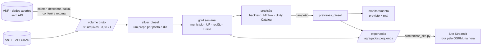

# Rota Econômica

Informe a rota e o caminhão: o site calcula o custo da viagem e diz **onde abastecer e quanto**,
com o preço do diesel que a ANP pesquisa em cada cidade do caminho e a economia em reais. Por trás,
um pipeline no Databricks coleta os preços toda semana e um modelo de previsão do diesel roda em
produção, com retreino, promoção por regra e monitoramento.

## Resultados

| Peça | Número |
|---|---|
| Histórico coletado | Preços da ANP de **maio de 2004 a novembro de 2026**, por posto: 85 arquivos e 3,8 GB, cada download conferido |
| Cobertura atual | **416 municípios** com preço de diesel S10 e 389 com diesel comum, cerca de 860 postos por semana só em SP |
| Previsão do diesel (backtest de 52 semanas) | Erro médio de **R$ 0,146/L**, contra R$ 0,149/L da base ingênua, com o intervalo de 80% acertando **80%** (a base: 68%) |
| Erro por horizonte | R$ 0,078/L a 1 semana, R$ 0,125 a 2, R$ 0,170 a 3, R$ 0,211 a 4 |
| Otimização do abastecimento | Exata: empata ou ganha da força bruta em 40 casos aleatórios |
| Exemplo real: São Paulo até Salvador | 1.968 km, R$ 7.365 com pedágio estimado; abastecer em Betim (MG) e Poções (BA) economiza **R$ 82** contra encher o tanque no primeiro posto sempre que precisa |

**Sobre o modelo:** o preço do diesel na bomba anda em degraus (os reajustes da Petrobras) e fica
parado entre eles, então repetir o preço atual é uma base difícil de bater. A primeira versão do
modelo, com árvores fundas, errava mais que ela e **não foi promovida**: a regra de promoção barrou.
A versão em produção usa o que acontece no resto do país, porque um reajuste chega aos estados em
semanas diferentes, e árvores rasas e regularizadas. O ganho no erro é modesto (2%); o ganho real
está no intervalo, que diz com honestidade onde o preço deve ficar.

## Como funciona



Um job semanal do Databricks, toda terça às 9h, faz tudo em quatro etapas: `coletar`, `camadas`,
`previsao` e `exportar`. Cada etapa é uma função do pacote Python deste repositório, testada no CI.

| Etapa | O que garante |
|---|---|
| Coleta | A ANP não tem API: o coletor lê a página, classifica os links (os nomes mudam sem aviso), confere o tamanho de cada download e continua de onde a conexão caiu. Só baixa o que mudou |
| Camadas | Silver arquivo por arquivo, só do que mudou; gold refeita com checagens (semana com poucos postos, preço fora da faixa) que param o job |
| Previsão | Backtest com origem móvel; o modelo novo só vira campeão se bater a base ingênua e o campeão atual por 2%; previsão em lote das próximas 4 semanas |
| Monitoramento | Compara o que foi previsto com o preço real e falha o job se o erro recente passar de 1,5 vez o do backtest |
| Site | Lê agregados exportados (não depende do Databricks no ar), traça a rota pelo OSRM com um segundo servidor de reserva e otimiza o abastecimento |

## Usar o site

**No seu computador:**

```bash
python -m venv .venv && .venv/Scripts/activate   # Linux/macOS: source .venv/bin/activate
pip install -e ".[dev]"
streamlit run app/streamlit_app.py
```

Abra o endereço que aparecer e clique em **Ver um exemplo**, ou escolha origem, destino e o
caminhão na barra lateral.

**Publicar no Streamlit Community Cloud:** em share.streamlit.io, crie um app apontando para este
repositório, branch `main`, arquivo `app/streamlit_app.py`. O `requirements.txt` já traz o que o
site precisa, e os dados vêm de `dados/site/`.

**Atualizar os dados do site:** com o Databricks CLI autenticado, `python scripts/sincronizar_site.py`.

## Desenvolver

```bash
pytest -q                              # 137 testes, sem internet e sem Databricks
databricks bundle deploy               # publica o job no alvo dev
databricks bundle run coleta_semanal   # coleta, camadas, previsão e exportação
```

## Limitações

- **Granularidade dos preços:** a ANP pesquisa uma amostra de postos em cerca de 400 municípios. As
  paradas sugeridas são essas cidades, com a mediana dos postos pesquisados.
- **Pedágio:** é estimado. Conta as praças federais concedidas (ANTT) na rota, vezes os eixos, vezes
  uma tarifa média editável, porque a ANTT não publica as tarifas. Rodovias estaduais ficam de fora.
- **Rota:** é a de carro do OSRM. Restrições de caminhão, como altura e peso, não entram.
- **Consumo:** é fixo, sem efeito de carga, relevo ou trânsito. O piso mínimo de frete ainda não
  entra no cálculo.

## Decisões

- [0001 · Arquitetura e ML em produção](docs/decisoes/0001-arquitetura-e-ml-em-producao.md)
- [0002 · Fontes de dados](docs/decisoes/0002-fontes-de-dados.md)
- [0003 · Dados brutos fora do Git](docs/decisoes/0003-dados-fora-do-git.md)
- [0004 · O site lê agregados exportados](docs/decisoes/0004-site-com-dados-exportados.md)

Dados: Agência Nacional do Petróleo, Gás Natural e Biocombustíveis (ANP), Agência Nacional de
Transportes Terrestres (ANTT) e IBGE, dados abertos. Rotas: © colaboradores do OpenStreetMap, via
OSRM.
